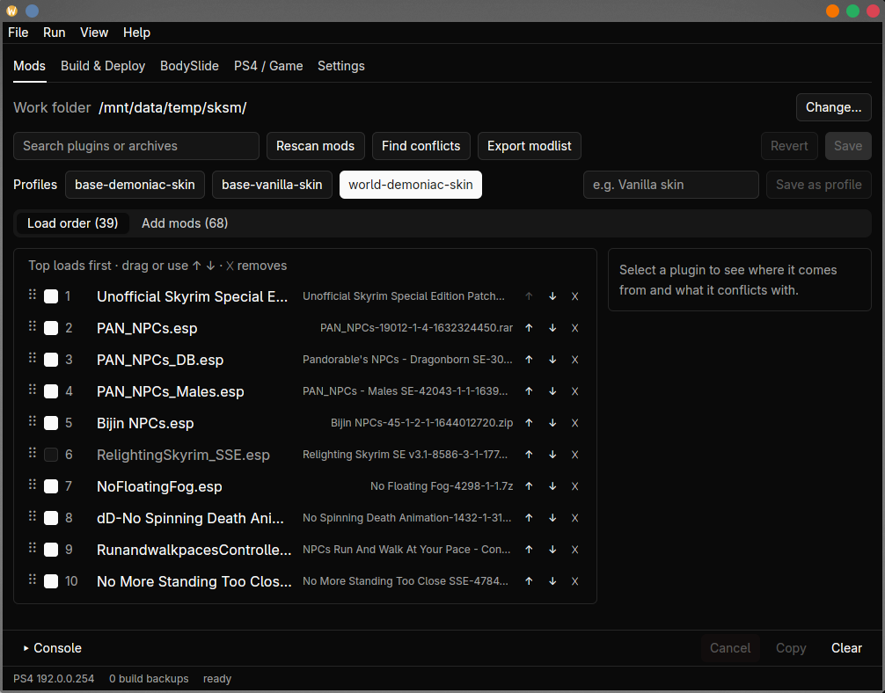
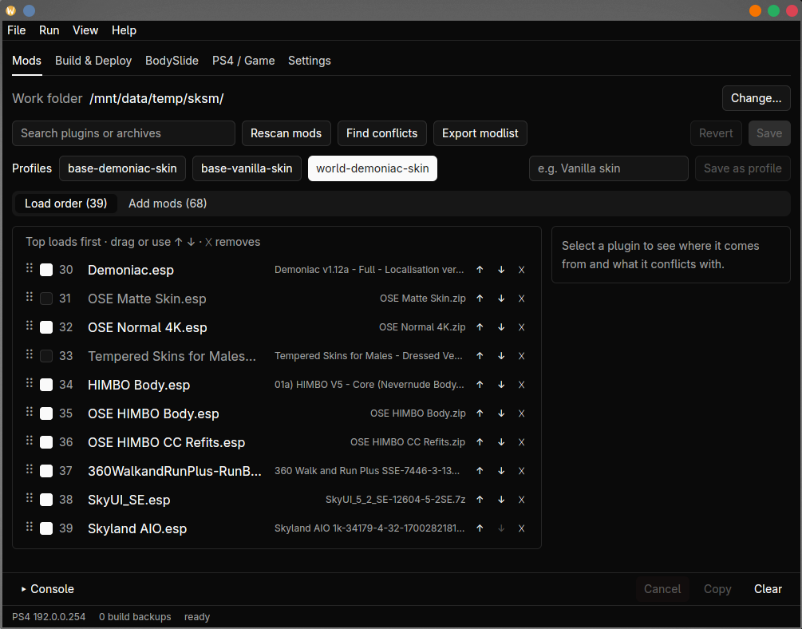
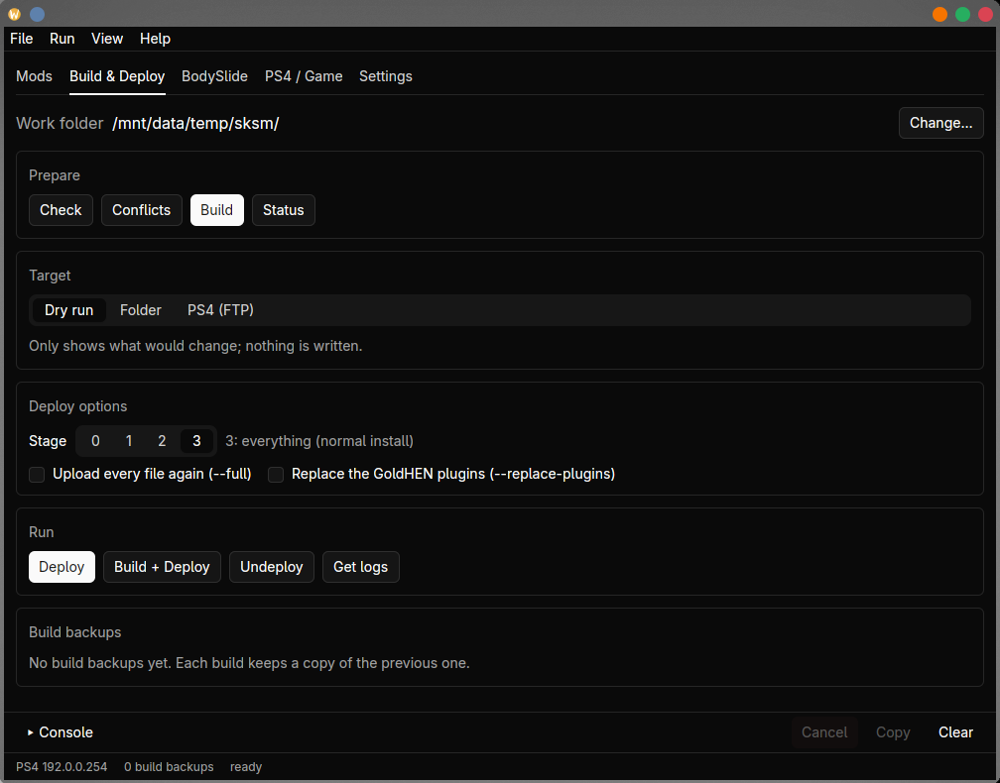

# SKPSM

**PC mods on your PS4, file by file.**

SKPSM installs PC mods on a PS4 with GoldHEN: it checks every mod, converts
what the console needs (textures to GNF, meshes, BodySlide, load order) and
uploads it over FTP, all from a desktop app or the command line.

- **Skyrim Special Edition** (version 1.32) — supported
- RE4 / RE3 — in development · RE2 and Cyberpunk 2077 — planned

<p align="center"></p>
<p align="center"></p>
<p align="center"></p>

## Downloads

| Platform | File | Notes |
|----------|------|-------|
| Linux (x86_64) | [SkPSM-0.1.0-x86_64.AppImage](https://github.com/Betest/skpsm-rust/releases/latest) | Runs without installing |
| Windows | coming soon | — |

### AppImage

```
chmod +x SkPSM-0.1.0-x86_64.AppImage
./SkPSM-0.1.0-x86_64.AppImage
```

The desktop app has tabs for Mods, Build & Deploy, BodySlide, PS4 / Game and
Settings. The `skpsm` CLI is bundled too.

SHA-256 (v0.1.0):

`41da8d1611b0ba4e0d0fae1798cc1b42da8ddcdbee85e6e3382b52635825d0eb`

## OSE plugin

Mods that need SKSE work through **OSE** (Orbis Script Extender), our GoldHEN
plugin for the PS4. Download `ose.prx` from the [latest
release](https://github.com/Betest/skpsm-rust/releases/latest), put it in
`/data/GoldHEN/plugins/` on the console and enable it in
`/data/GoldHEN/plugins.ini` — or let `skpsm deploy` do both when `[goldhen]
ose_local` in `config.ini` points to your local copy. Built with the OpenOrbis
toolchain and the GoldHEN Plugins SDK. GPL-3.0; the source is attached to the
release.

## Website

Documentation and email updates: <https://skpsm.it-bridge.workers.dev>

## Disclaimer

Read [DISCLAIMER.md](DISCLAIMER.md). You need a legal copy of Skyrim Special
Edition. We do not support piracy.

## License and credits

- License: [Apache-2.0](LICENSE) — see also [NOTICE](NOTICE)
- Credits: [CREDITS.md](CREDITS.md)
- The source code is not published for now.
